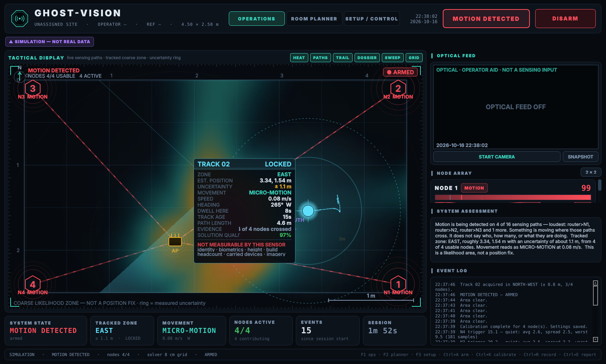
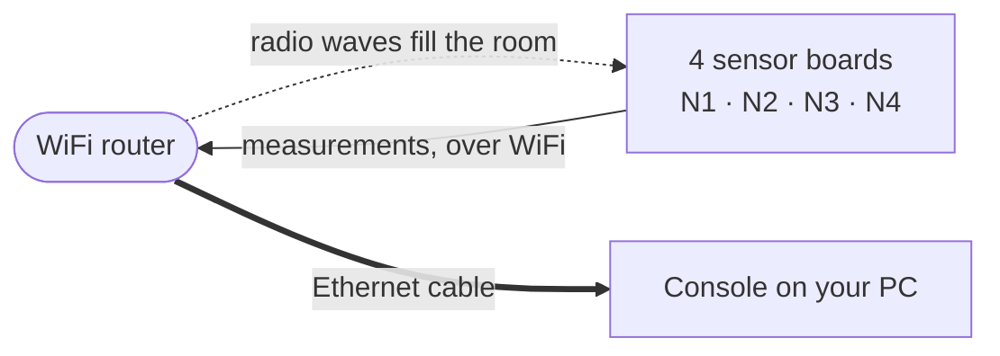
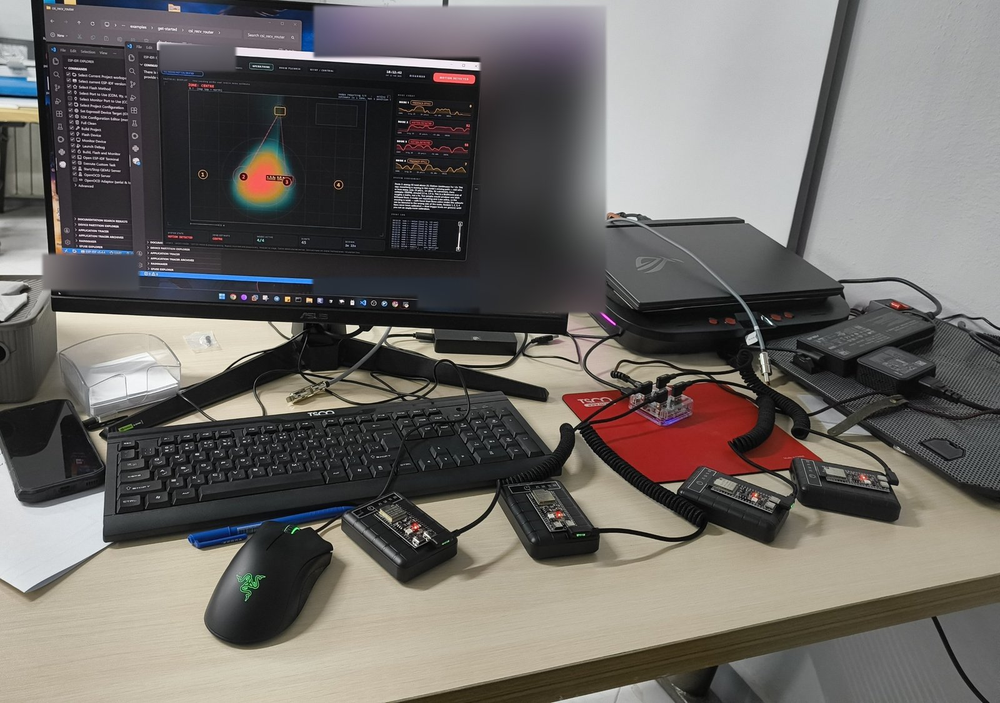
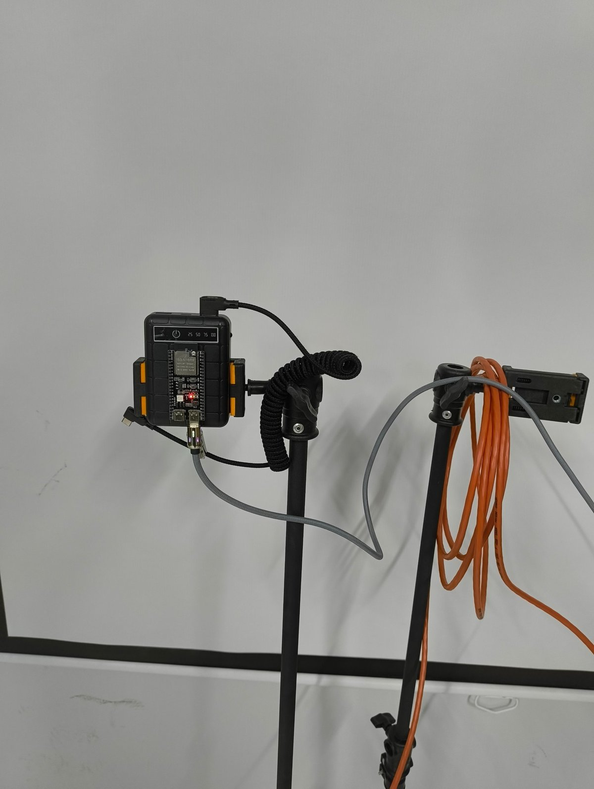
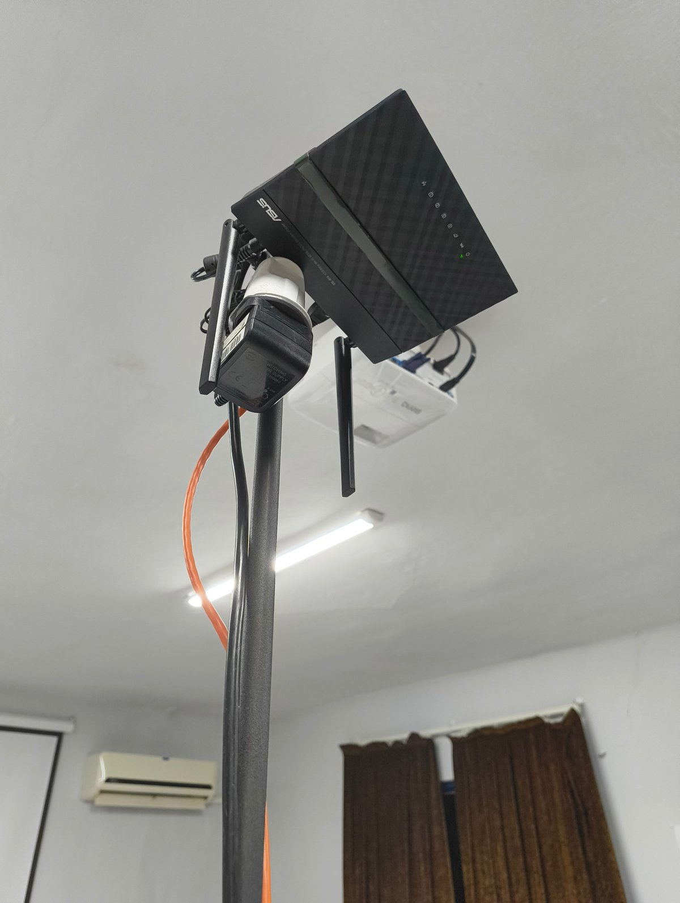
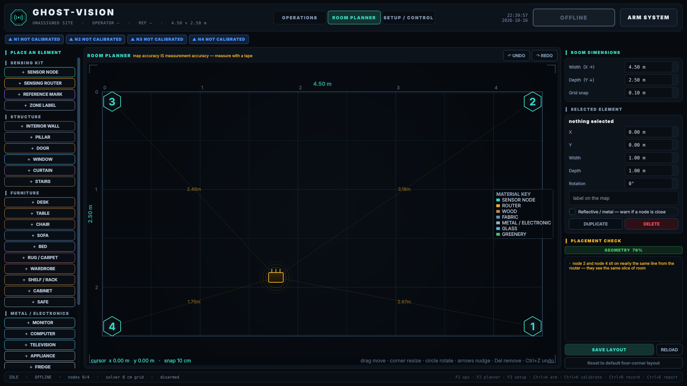
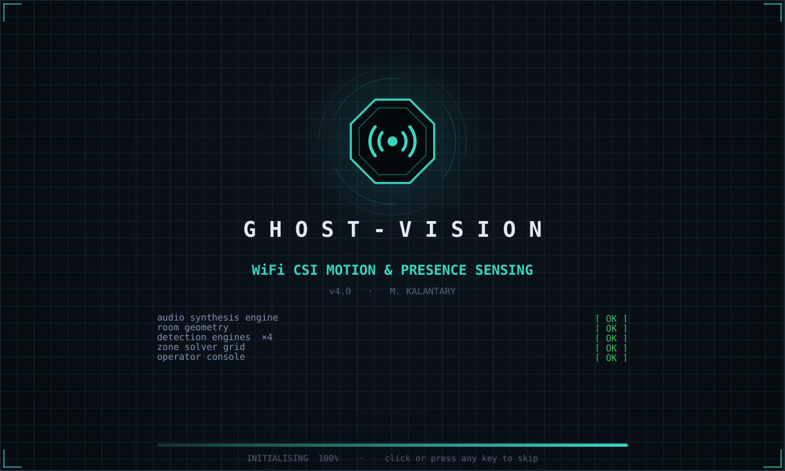

# Ghost-Vision

**Detects people moving in a room using only WiFi — no cameras.**

The console in simulation mode: a virtual person walks the room, the WiFi paths they disturb turn red, and their approximate zone is drawn with an uncertainty ring. Simulated data — not a field measurement.

---

## The idea, in 30 seconds

Imagine a calm swimming pool. On one side, a machine makes small, steady waves. On the other side, a float feels the waves arrive. While nobody is in the pool, the waves always look the same. The moment someone steps in, the pattern changes — even if you can't see them.

Ghost-Vision does the same thing with WiFi. A router fills the room with radio waves. Four small sensor boards feel how those waves arrive. Your body is mostly water, and water disturbs radio waves — so when you move, the boards notice. A program on your PC turns that into **"someone is moving"**, and shows roughly where.

No camera. No picture. Nothing that identifies who you are. It even works in the dark.

---

## Choose your path

| I want to… | Start here | Time |
|---|---|---|
| **See it working, with no hardware** | Download the project, then double-click [`run_simulation.bat`](run_simulation.bat) (Windows) or run [`bash run_simulation.sh`](run_simulation.sh) (macOS / Linux) | 10 minutes |
| **Build my own** | [The step-by-step guide](docs/GUIDE.md) | An afternoon |
| **Understand how it works** | [How it works](docs/how-it-works.md) | 10-minute read |
| **Know what it can't do** | [Limitations](docs/limitations.md) and the [FAQ](docs/FAQ.md) | 5 minutes |
| **Fix a problem** | [Troubleshooting](docs/TROUBLESHOOTING.md) | |
| **Help out** | [Contributing](CONTRIBUTING.md) | |

---

## Status

> **Bench-tested; field measurements still to come.**
> The radio link, firmware and console are complete and measured — see [Measured results](#measured-results).
> **How often it detects a person, and how often it raises a false alarm, haven't been measured in a real room yet.** The test room is unavailable from October 2026 for at least a month. Those two numbers will be published here when they're measured — not estimated.
>
> Want to help? [Measure your own setup](docs/measuring-your-setup.md) and share the results.

---

## What it can and can't do

| ✅ It can | ❌ It can't |
|---|---|
| Detect movement in a room | Show a picture, outline or skeleton |
| Tell an empty room from an occupied one *(experimental)* | Count how many people are present |
| Show roughly which part of the room the movement is in, with an honest uncertainty ring | Give an exact position |
| Work in total darkness, and through furniture, doors and light walls | Identify anyone, or detect hidden devices |
| Keep working if one of the four boards fails | Sense through reinforced concrete, or into a room it isn't set up around |

Every item on the right is a limit of the physics, not missing work. [limitations.md](docs/limitations.md) explains each one.

---

## How the parts fit together

The boards listen to the router **and to each other**. Four boards and a router make **10 radio paths** that criss-cross the room. Each pair of boards is measured from both ends, giving **16 measurements**, about 50 times a second each. When a body moves, several crossing paths change at once — and the console only reports motion when **at least two paths agree**, so one glitchy path can't raise a false alarm.

---

## What you need to build one

- **4 × ESP32-S3** development boards — a few dollars each
- **1 × spare WiFi router** you can configure
- USB **data** cables, USB wall chargers and one Ethernet cable
- A PC (developed and tested on Windows)

Roughly **$60–100** in parts, excluding the PC. Full list and every step: **[the guide](docs/GUIDE.md)**.

---

## The real hardware

An early bench test of console v3 with live data from four real boards, before calibration. The boards are on a desk, not in the room's corners, so this shows the whole chain working end to end. It doesn't show detection performance.

| A sensor board on its stand | The router, mounted in the room |
|---|---|
|  |  |

---

## More screens

| Room planner | Start-up |
|---|---|
|  |  |
| Map your room to scale and get a placement score before you install. | Each line is a real start-up step; if one fails, you see exactly which. |

---

## Measured results

Measured on the bench with four boards, over 60-second runs:

| What was measured | Result |
|---|---|
| Measurements lost between boards and PC | 0.00 % – 0.17 % per board |
| How closely the four boards' data rates agree | Within 0.2 % |
| Measurements received from each board | About 310 per second |
| Board-to-board paths | 78–80 per second, each |
| **Detection rate** | **Not yet measured** |
| **False alarms per 24 hours, empty room** | **Not yet measured** |

In a computer simulation of the test room, the 4 router paths alone left 22 of 80 test points more than 0.75 m from any path. All 16 paths together left none. That's a simulation, not a field measurement.

---

## What's in this repository

| Folder / file | What it is |
|---|---|
| [`run_simulation.bat`](run_simulation.bat) / [`.sh`](run_simulation.sh) | One-click start, no hardware |
| [`run_ghost_vision.bat`](run_ghost_vision.bat) / [`.sh`](run_ghost_vision.sh) | One-click start, with your boards |
| [`firmware/`](firmware/) | The program for the four boards |
| [`console/`](console/) | The PC program, plus two small checking tools |
| [`docs/`](docs/) | Guide, troubleshooting, explanations, glossary |
| [`data/sample/`](data/sample/) | Real recorded data, to explore or test with |

**All documentation:** [Guide](docs/GUIDE.md) · [Troubleshooting](docs/TROUBLESHOOTING.md) · [FAQ](docs/FAQ.md) · [Glossary](docs/GLOSSARY.md) · [How it works](docs/how-it-works.md) · [Limitations](docs/limitations.md) · [Measuring your setup](docs/measuring-your-setup.md) · [Data formats](docs/data-format.md) · [Lessons learned](docs/lessons-learned.md) · [Responsible use](docs/responsible-use.md)

---

## Lessons learned

This project has made confident-sounding changes that turned out to be wrong — including an "upgrade" predicted to make positioning 4.6× better that, once measured, made it worse. Every one is written down in [lessons-learned.md](docs/lessons-learned.md), because the mistakes are probably the most useful part for anyone building something similar.

---

## Use it responsibly

Ghost-Vision senses people, even though it never sees them. Use it in spaces you're responsible for, tell the people who use those spaces, and check your local laws. More in [responsible-use.md](docs/responsible-use.md).

---

## Help, ideas and contributions

- **Something not working?** Check [Troubleshooting](docs/TROUBLESHOOTING.md), then [ask a question](https://github.com/mkalantary/ghost-vision/issues/new/choose).
- **Found a bug, or have an idea?** [Open an issue](https://github.com/mkalantary/ghost-vision/issues/new/choose).
- **Want to contribute?** Read [CONTRIBUTING.md](CONTRIBUTING.md). Beginners are welcome.
- **Found a security problem?** Please follow [SECURITY.md](SECURITY.md).

Using Ghost-Vision in research? See [CITATION.cff](CITATION.cff), or use **"Cite this repository"** on the GitHub page.

---

## Acknowledgements

- The firmware is built on Espressif's [esp-csi](https://github.com/espressif/esp-csi) `csi_recv_router` example. Thank you to Espressif for publishing it openly.
- Developed with the help of Claude, an AI assistant made by Anthropic.

## License

© 2026 M. Kalantary. Apache License 2.0 — see [LICENSE](LICENSE) and [NOTICE](NOTICE). Free to use, change and share, including commercially, as long as the copyright notices are kept.
