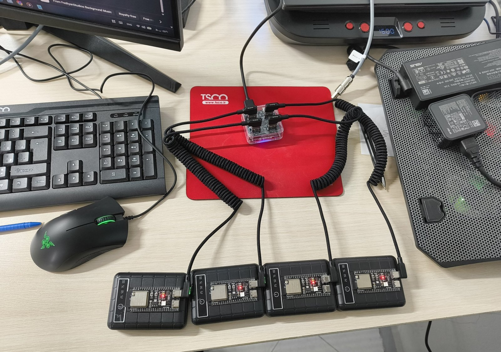

# The Ghost-Vision Guide

**From an empty desk to "MOTION DETECTED", one step at a time.**

You don't need to know electronics, programming or networking. Every step says exactly what to click or type, and ends with a ✅ **check** — what you should see if it worked. If you don't see it, stop there and look up that step in [TROUBLESHOOTING.md](TROUBLESHOOTING.md). Don't skip ahead; each step builds on the one before.

New words are explained in the [Glossary](GLOSSARY.md).

| Part | What you do | Time |
|---|---|---|
| [0. Try it with no hardware](#part-0--try-it-with-no-hardware) | See the software working on your PC | 10 min |
| [1. Get the parts](#part-1--get-the-parts) | Buy four boards, a router and cables | — |
| [2. Set up the router](#part-2--set-up-the-router) | Make the router a dedicated "sensing" WiFi | 20 min |
| [3. Connect your PC](#part-3--connect-your-pc) | Give your PC a fixed address on that network | 10 min |
| [4. Install the tools](#part-4--install-the-tools) | Python and Espressif's ESP-IDF | 30–60 min |
| [5. Program the first board](#part-5--program-the-first-board) | Put the firmware on board 1 and read its MAC | 20 min |
| [6. Program all four boards](#part-6--program-all-four-boards) | Give each board its identity | 20 min |
| [7. Check the data is arriving](#part-7--check-the-data-is-arriving) | Prove the boards reach your PC | 10 min |
| [8. Map the room](#part-8--map-the-room) | Tell the software where everything is | 15 min |
| [9. Calibrate and detect](#part-9--calibrate-and-detect) | Teach it the empty room, then walk in | 10 min |

---

## Part 0 — Try it with no hardware

Before buying anything, see the software working. It has a built-in simulation: four virtual boards, a virtual room and a virtual person who walks around.

1. **Install Python** from [python.org/downloads](https://www.python.org/downloads/).
   On Windows, on the first screen of the installer, tick **"Add python.exe to PATH"**.
2. **Download this project.** On the GitHub page, click the green **Code** button → **Download ZIP**, then unzip it somewhere easy, like your Desktop.
3. **Start it.**
   - **Windows:** double-click **`run_simulation.bat`**.
   - **macOS / Linux:** open a terminal in the project folder and run `bash run_simulation.sh`.

The first time, it downloads what it needs. That takes a few minutes. Later starts are quick.

✅ **Check:** a boot screen appears, then the console. A purple banner says **SIMULATION — NOT REAL DATA**, and after a short while a virtual person starts walking. That's it — you've run Ghost-Vision.

> **Tip:** to see real detection in the simulation, go to **SETUP / CONTROL** and press **CALIBRATE ALL NODES** while the virtual room is empty (the person leaves and comes back every 90 seconds). The simulation is for learning the software — it is not evidence that detection works in a real room. Only Parts 1–9 can tell you that.

---

## Part 1 — Get the parts

| Item | How many | Notes | Rough cost |
|---|---|---|---|
| **ESP32-S3 development board** | 4 | Any ESP32-S3 board with a USB connector. Developed on ESP32-S3-WROOM-1 (N16R8). | $6–10 each |
| **WiFi router** | 1 | Must let you **fix the channel**, set **20 MHz** width and choose **WPA2**. Use a spare one — it becomes a dedicated sensing network, not your home WiFi. | $25–45 |
| **USB cables** | 1–4 | Must be **data** cables. Many cheap cables only charge — they will light the board but your PC won't see it. | |
| **USB wall chargers** (5 V, 1 A or more) | 4 | To power the boards once programmed. | |
| **Ethernet cable** | 1 | Router to PC. | |
| **A PC** | 1 | Developed and tested on Windows. Needs an Ethernet port (or a USB-Ethernet adapter). | |
| **Tape measure** | 1 | For the room map. Accuracy here becomes accuracy on screen. | |

Prices are rough guides and change. Total, excluding the PC: roughly **$60–100**.

> **Powerbanks?** Fine for a quick demo, but many switch themselves off when the current drawn is small, and a board draws only 100–150 mA. If a board "dies overnight", that's usually why. Use wall chargers for anything longer.

✅ **Check:** plug one board into your PC with your cable. Windows makes the "device connected" sound, or a new port appears in **Device Manager → Ports (COM & LPT)**. If nothing happens, try a different cable before anything else.

---

## Part 2 — Set up the router

Your router becomes a private, dedicated network that only the four boards and your PC use. It **doesn't need an internet connection.**

Open the router's settings page in a browser (the address and password are usually on a sticker underneath it). Router menus differ by brand; look for these settings:

| Setting | Set it to | Why |
|---|---|---|
| **Band** | 2.4 GHz | The boards use 2.4 GHz |
| **Channel** | A **fixed** number, e.g. **6** — never "Auto" | If the channel changes, every measurement baseline is lost |
| **Channel width / bandwidth** | **20 MHz** | 40 MHz gives inconsistent measurements |
| **Wireless mode** | **802.11n only** (or "N only") | |
| **Security** | **WPA2-Personal (AES)** | WPA3 and "mixed" modes stop the boards joining |
| **Network name (SSID)** | Something plain, letters and numbers only, e.g. `sensors-lab` | Avoid your name or company name — a sensor network named after its owner is a signpost |
| **Password** | Your choice | You'll type it into the firmware in Part 5 |
| **Group key update interval / rotation** | **0** or **Off** | Otherwise you get a fake "motion" event every hour, on the hour |
| **AP isolation / client isolation** | **Off** | The boards must be able to hear each other |
| **Packet aggregation** | **Off** (if the option exists) | |
| **Router's own address (LAN IP)** | **10.8.0.1**, subnet mask **255.255.255.0** | Matches the project's defaults — easiest path |
| **DHCP address range** | **10.8.0.100** to **10.8.0.200** | The boards get their addresses from here |

> **Changing the router's address will disconnect your browser.** That's normal. Continue with Part 3, then open `http://10.8.0.1` to get back in.

> **Want to keep a different address range?** It works, but you'll change two extra settings later — see [Using a different address range](TROUBLESHOOTING.md#using-a-different-address-range). Copying the table above is much easier.

<br>
<sub>The test setup's router, mounted on a pole inside the room it senses.</sub>

✅ **Check:** after saving, the router restarts and your phone can see the new network name in its WiFi list. (Don't connect your phone or PC to it over WiFi — only the boards join by WiFi.)

---

## Part 3 — Connect your PC

Your PC talks to the boards through an **Ethernet cable**, not WiFi.

1. Plug the Ethernet cable into your PC and into one of the router's numbered **LAN** ports (not the "WAN" or "Internet" port).
2. Give your PC a fixed address. On **Windows 11**:
   **Settings → Network & internet → Ethernet → IP assignment → Edit → Manual → IPv4: On**, then fill in:

   | Field | Value |
   |---|---|
   | IP address | `10.8.0.50` |
   | Subnet mask | `255.255.255.0` |
   | Gateway | *leave empty* |
   | Preferred DNS | *leave empty* |

   Click **Save**. (On Windows 10: **Control Panel → Network and Sharing Center → Change adapter settings → right-click Ethernet → Properties → Internet Protocol Version 4**.)

**Why no gateway?** If you give this connection a gateway, Windows may try to send your internet traffic through the sensing router, which has no internet. Leaving it empty keeps your normal internet working over WiFi.

✅ **Check:** open `http://10.8.0.1` in your browser. The router's settings page loads, and your normal internet still works.

> **Using a mobile hotspot or second network at the same time?** Make sure it doesn't also use `10.8.0.x`. If two connections claim the same addresses, Windows silently picks one and things stop working in confusing ways.

---

## Part 4 — Install the tools

You need two things: **Python** (for the console — you may have it from Part 0) and **ESP-IDF**, Espressif's free toolkit for programming the boards.

### ESP-IDF version 5.4.4

The project is built and tested with **ESP-IDF v5.4.4**. Version 6 is untested — stick to 5.4.4.

**Windows:**

1. Go to Espressif's [ESP-IDF Windows installer page](https://dl.espressif.com/dl/esp-idf/).
2. Download **"ESP-IDF v5.4.4 – Offline Installer"**. It's a large file (about 1.6 GB), so give it time.
3. Run it and accept the defaults. It installs a lot — this can take a while.
4. When it finishes, it adds an **ESP-IDF Command Prompt** shortcut to your Start menu. **Always use that window** for the `idf.py` commands in this guide; a normal command prompt doesn't know them.

**macOS / Linux:** follow Espressif's official [ESP-IDF v5.4.4 Get Started guide](https://docs.espressif.com/projects/esp-idf/en/v5.4.4/esp32s3/get-started/index.html).

✅ **Check:** open **ESP-IDF Command Prompt** and type:

```
idf.py --version
```

It prints a version starting with `v5.4.4`.

---

## Part 5 — Program the first board

### 5.1 — Put in your WiFi details

Open the file **`firmware/sdkconfig`** in a text editor (Notepad is fine). Use **Find** to locate these two lines and replace the placeholders with your network name and password from Part 2. Keep the quote marks.

```
CONFIG_EXAMPLE_WIFI_SSID="YOUR_SSID"
CONFIG_EXAMPLE_WIFI_PASSWORD="YOUR_PASSWORD"
```

Save the file.

> ⚠️ **Never run `idf.py set-target`** in this project. The settings file is already set up for ESP32-S3, and `set-target` rebuilds it from scratch — wiping your WiFi details and a setting that prevents boards freezing at start-up.

> 🔒 **If you ever share or upload your copy of this project, put the placeholders back first.** This file now contains your WiFi password.

### 5.2 — Find the board's port

Plug in **one** board. In Windows **Device Manager → Ports (COM & LPT)**, note its name, e.g. **COM5**.

> COM numbers belong to the **USB socket**, not the board. Plug a board into a different socket and its number can change.

### 5.3 — Build and flash

In **ESP-IDF Command Prompt**, go to the firmware folder (use your own path) and build:

```
cd C:\Users\you\Desktop\ghost-vision\firmware
idf.py build
```

The first build takes several minutes and needs internet — it downloads one extra Espressif component. Then flash it and watch the board's output (use your COM number):

```
idf.py -p COM5 flash monitor
```

### 5.4 — Read the board's address

When flashing finishes, the board restarts and prints a banner. If you missed it, press the board's **RESET** (or **RST**) button.

```
==========================================
  GHOST-VISION
  THIS BOARD IS NODE N4
  MAC 12:34:56:78:9a:bc
  ...
```

**Write down the MAC address** — six pairs of characters. This is the board's unique hardware address. Put a piece of tape on the board and label it **N1**.

Press **Ctrl + ]** to leave the monitor.

✅ **Check:** you have a banner, a MAC address written down, and a labelled board. (It says N4 for now — that's the default in the file. You'll fix it in Part 6.)

Repeat **5.2 → 5.4 only** for the other three boards: plug in each one, flash it, write down its MAC, and label it **N2**, **N3**, **N4**. You don't need to repeat 5.1.

---

## Part 6 — Program all four boards

Each board needs to know **who it is** and **who its three neighbours are**.

### 6.1 — Enter the four MAC addresses

Open **`firmware/main/app_main.c`**. Search for `REPLACE`. You'll find two identical tables of placeholders:

```c
{0x02, 0x00, 0x00, 0x00, 0x00, 0x01},   /* N1  <- REPLACE with this board's MAC */
```

Turn each MAC you wrote down into this format: put `0x` in front of each pair and separate them with commas. For example, the MAC `12:34:56:78:9a:bc` becomes:

```c
{0x12, 0x34, 0x56, 0x78, 0x9a, 0xbc},   /* N1 */
```

Fill in N1–N4 in **both** tables (search for `GV_KNOWN` and `GV_NODE_MAC`). The two tables must match.

> **Using fewer than four boards?** Fill in the boards you have, numbered from N1 upwards, and leave the other placeholders as they are. Four is recommended for coverage, but not required — see [the README](../README.md#do-you-need-four-boards).

### 6.2 — Give each board its number

In the same file, search for this line:

```c
#define GV_NODE_ID                 4
```


<sub>A USB hub lets all four boards stay plugged in at once. Each socket gets its own COM number, so check which board is on which port.</sub>

Now, **for each board in turn**:

1. Change the number to that board's label: `1` for N1, `2` for N2, and so on.
2. **Save the file (Ctrl + S).** Forgetting to save is the most common mistake here.
3. Plug in that board and run `idf.py -p COM5 flash monitor` (with its COM number).
4. Check the banner says the right node, then press **Ctrl + ]**.

✅ **Check:** each board's banner shows **its own** number — `THIS BOARD IS NODE N1` on the board labelled N1, and so on. A few seconds later, a status line appears every 5 seconds. In its `heard/5s` row, the board's **own** number should show `0` — a board can't hear itself — and the other numbers should be above zero once all four boards are powered.

---

## Part 7 — Check the data is arriving

1. Power all four boards from the wall chargers and put them in the room's four corners, at roughly the same height. Put the router inside the room too.
2. On your PC, open a command prompt in the project's **`console`** folder and run the small checking tool:

   **Windows:**
   ```
   .venv\Scripts\python gv_listen.py
   ```
   **macOS / Linux:**
   ```
   .venv/bin/python gv_listen.py
   ```

   (The `.venv` folder was created the first time you ran a launcher in Part 0.)

   <br>
   <sub>One sensor board on a light stand. A phone clamp holds it. This one runs from a powerbank for a short test; for anything longer, use a wall charger (see Part 1).</sub>

3. **Windows Firewall** may pop up asking whether to allow Python. Tick **Private networks** and click **Allow**. If you missed the pop-up, see [TROUBLESHOOTING.md](TROUBLESHOOTING.md#no-data-arrives-at-the-pc).

✅ **Check:** within about 10 seconds you see `Node N1 appeared` and the same for N2–N4, followed by one line per node per second showing `pkt/s`, `rssi` and `loss` close to **0%**. Walk between a board and the router — its numbers react.

Press **Ctrl + C** to stop. Only one program can receive the data at a time, so always stop this tool before starting the console.

---

## Part 8 — Map the room

Double-click **`run_ghost_vision.bat`** (Windows) or run `bash run_ghost_vision.sh` (macOS / Linux). This starts the console with your real boards.

1. Go to the **ROOM PLANNER** tab.
2. Under **ROOM DIMENSIONS**, type the room's real width and depth in metres.
3. Drag the four nodes and the router to **where they really are**. Measure with the tape — the map is part of the measurement, and an inaccurate map means an inaccurate zone on screen.
4. Optionally add walls, doors and large furniture. Mark metal objects as reflective; the planner warns you if a node is too close to one.
5. Check the **PLACEMENT CHECK** score and read its advice.
6. Click **SAVE LAYOUT**.

✅ **Check:** the map on the **OPERATIONS** tab matches your real room, with each node in the right corner.

---

## Part 9 — Calibrate and detect

Calibration teaches the system what **your empty room** looks like. Every room is different, so this is not optional.

1. Go to **SETUP / CONTROL** and click **CONNECT ALL**.
2. Wait until all four nodes show as connected.
3. Click **CALIBRATE ALL NODES** (or press **Ctrl + K**).
4. **Leave the room** and close the door. You have 20 seconds to walk out, then it measures for 30 seconds. Pets and fans out too, please.
5. Come back. If someone moved during the measurement, it **refuses** to calibrate and tells you why — just try again.
6. Go to **OPERATIONS** and click **ARM SYSTEM**.
7. Walk into the room.

✅ **Check:** the status changes to **MOTION DETECTED**, the paths you cross light up, and a zone with an uncertainty ring appears on the map. Leave, and after a short while it returns to **AREA CLEAR**.

🎉 **That's it — you've built a working Ghost-Vision system.**

---

## What next?

- **Measure how well it works in your room** — [measuring-your-setup.md](measuring-your-setup.md). If you share your numbers, you help everyone.
- **Fine-tune it** — [TROUBLESHOOTING.md](TROUBLESHOOTING.md) has a table of symptoms and settings.
- **Understand why it works** — [how-it-works.md](how-it-works.md).
- **Know its limits** — [limitations.md](limitations.md).
- **Use it responsibly** — [responsible-use.md](responsible-use.md).

**Recalibrate whenever something changes:** a node is moved, furniture is rearranged, or the router is moved or reset.
