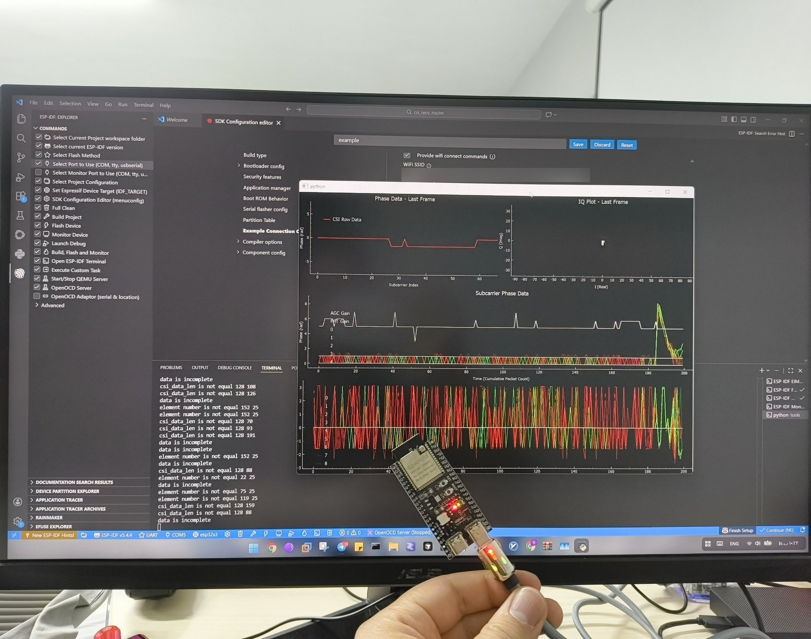

# Lessons learned

Mistakes made while building this, written down so nobody has to make them twice — including us. Some of it is technical; the [Glossary](GLOSSARY.md) explains the terms. The pattern underneath almost all of them: **a plausible mechanism is not evidence.** Validate the instrument, then run a controlled experiment.

## Claims that turned out wrong

**"Sixteen paths will improve positioning 4.6×."** Shipped. Measured: *worse* than four paths (0.67 m vs 0.61 m error). The simulation used the same geometric model the solver assumes, so it tested the solver against its own beliefs and couldn't catch a wrong belief. The real problem: wall-hugging paths between corner nodes are short, strong, and barely disturbed by someone crossing the room. Positioning stays on 4 paths until per-path sensitivity is measured from real walks.

**"UDP loss is 1.0–1.4 %."** The measuring tool was broken — window-edge arithmetic invented ~2 % loss and could report *negative* loss. Rewritten and validated against deliberately injected loss. True loss: 0.00 %.

**"Serial printing is throttling the radio."** Turning printing off made the rate *lower*, not higher. What actually fixed the unsteady rate was asking for 50 pings per second instead of 100. The first explanation offered for *why* — the operating system's 10 ms timer tick — doesn't match this build's settings (it uses a 1 ms tick), so the cause is still not fully understood. The fix is measured; the explanation isn't.

**"Frame length identifies the frames we want."** Wrong quantity entirely. CSI comes from the preamble, so frames of any length are comparable. It worked by accident while only one transmitter was audible.

**"Rate alone is a sufficient fingerprint."** The field means a legacy rate index in one mode and an MCS index in another, so two formats both read "11." For HT frames the MCS must be excluded, or normal rate adaptation looks like a new frame type.

**"`MASK_DATA` is the tidy promiscuous filter."** It silently killed the router link — 2 frames per 5 s instead of ~940. An access point labels downlink frames differently from a station's uplink.

**"Keep 1 in N records to shed load."** Needs the incoming rate known in advance, and it varied 10×. Replaced with a per-link rate cap.

**Records pushed into the engine twice.** Predicted effect: lower sensitivity. Measured: the opposite — inflated levels and flickering detections. Caught only by testing at a signal level that didn't saturate.

**One flag doing two jobs.** `ready` meant both "don't score this window" and "this node isn't ready" — so a gate meant to block phantom alarms also blocked real detection on any node it fired on. Split into two flags.

**Calibrating silent paths.** Calibration forced paths receiving nothing to look connected, so they calibrated on nothing and kept meaningless thresholds.

## Things that look like motion but aren't

- **Automatic gain control jumps.** Fixed by normalising each packet by its own mean.
- **Packet-rate dips.** Variance grows with observation time; a fixed packet-count window spans more time when the rate drops. Fixed with a timing gate.
- **Hourly group-key rotation** on the router. Phantom event on the hour, every hour.
- **The console's own announcements.** Sent by the router, they pass every filter; at 2 Hz they were 17 % of a learning window. Now every 2 s.

## Operational lessons

- **Intermittent silent boot failure is the worst possible fault for wall-mounted hardware.** IPv6 in the connect step caused exactly that.
- **Serial port numbers follow the USB socket, not the board.** One "dead board" scare was the wrong port.
- **Boards huddled on a table measure the air between three objects, not the room.** Put them back on their mapped positions before any test.
- **Recalibrate after any change to the data path.** Three calibrations were once done against inflated readings.
- **Three console builds in a row made things worse** because there was no way to tell an improvement from a plausible-sounding change. A measurement rig — tape marks, a fixed walk route, logged ground truth — is the precondition for every further change.

## Where it started

Day one: one board running Espressif's stock esp-csi example, plotting raw CSI. Everything in this repository grew from here.

The desk test in the README's main photo is also the mistake described above: boards huddled together measure the air between them, not the room. It proves the data chain works, and nothing more.
